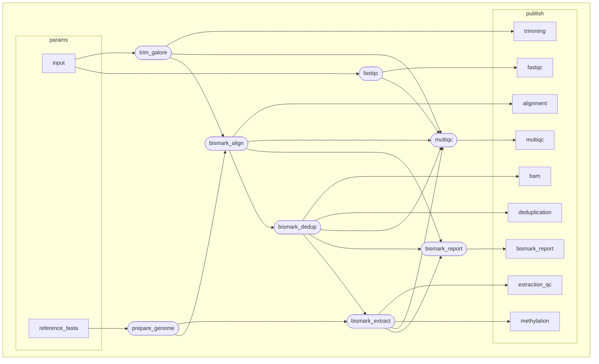

# methyl_step_iii

A Nextflow pipeline for processing paired-end bisulfite sequencing data and extracting DNA methylation levels at CpG sites.

The pipeline performs raw read quality control (FastQC), adapter and quality trimming (Trim Galore), bisulfite reference genome preparation, read alignment (Bismark/Bowtie2), PCR duplicate removal, and methylation extraction. Quality control reports are summarized using MultiQC.

All tools are executed in Docker containers.

## Requirements

- Nextflow ≥ 25.10
- Docker


## DAG



## Test data

The pipeline includes a sample sheet with the `Ecoli_10K_methylated` paired-end test dataset and a small reference genome (48,502 bp) from [nf-core/test-datasets](https://github.com/nf-core/test-datasets), branch `methylseq`.

FASTQ files and the reference genome are downloaded automatically.

## Input

Input samples are specified in `assets/samplesheet.csv` with three columns:

| sample_id | fastq_1 | fastq_2 |
|---|---|---|
| sample_A | /path/to/sample_A_R1.fastq.gz | /path/to/sample_A_R2.fastq.gz |
| sample_B | /path/to/sample_B_R1.fastq.gz | /path/to/sample_B_R2.fastq.gz |


The reference FASTA is specified using `params.reference_fasta` in `nextflow.config`.

## Output

Results are saved to the `results/` directory:

| Directory | Contents |
|---|---|
| `fastqc/` | FastQC HTML and ZIP reports |
| `bam/` | Deduplicated BAM files |
| `methylation/` | CpG coverage (`.bismark.cov.gz`), bedGraph, and genome-wide CpG reports |
| `reports/` | Trimming, alignment, deduplication, extraction, and Bismark HTML reports |
| `multiqc/` | Combined MultiQC HTML report |

The main output is the CpG coverage file, containing genomic coordinates, methylation percentages, and methylated/unmethylated read counts.

## Usage

```bash
nextflow run vvbasova/methyl_step_iii
```


